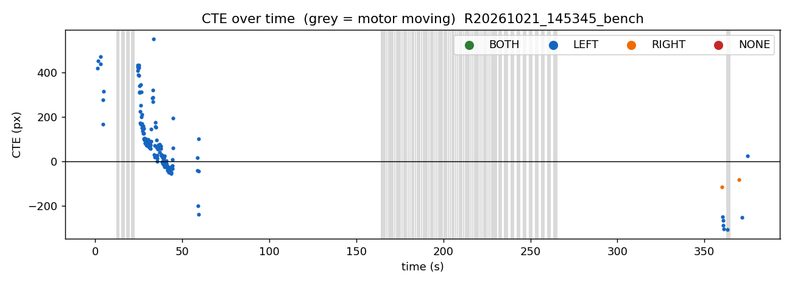
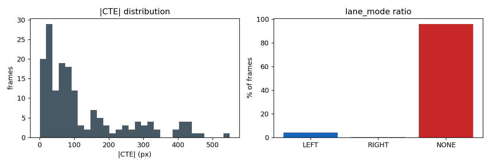
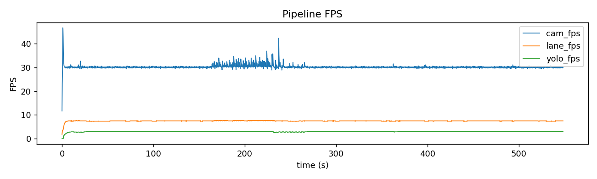
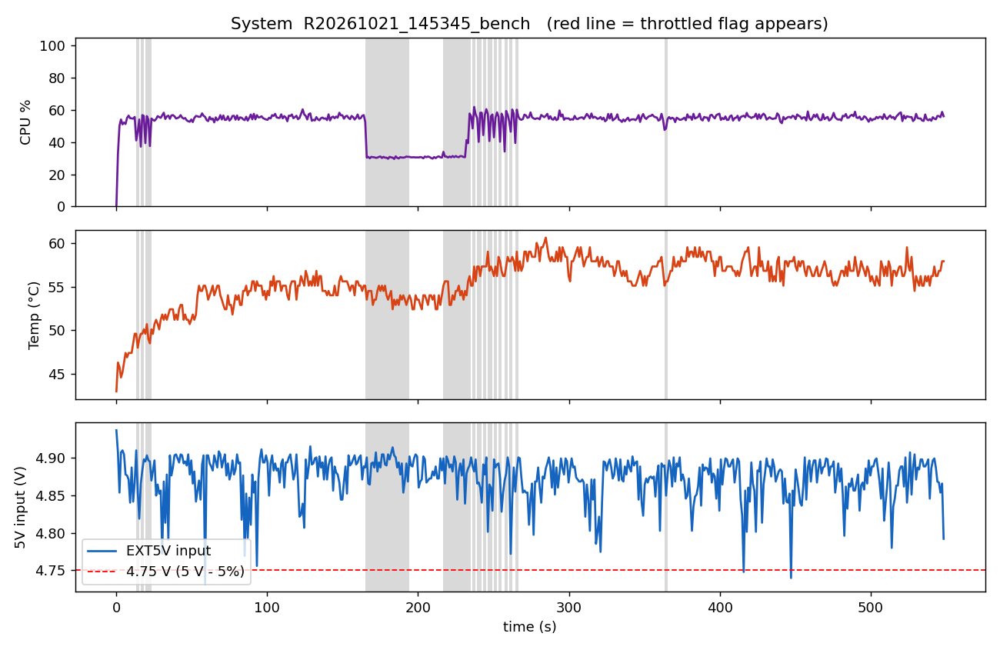
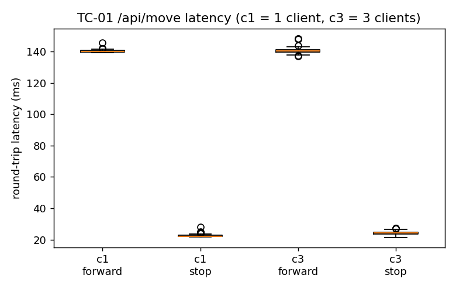
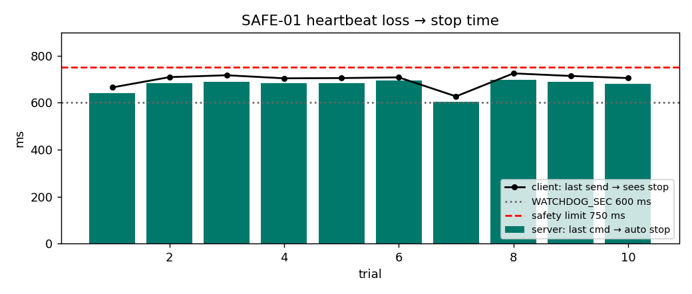

# 測試結果摘要

自動產生：`python tools/analyze.py`

## 車道偵測（R20261021_145345_bench）

| 指標 | 數值 |
|---|---|
| 影格數 | 4103 |
| 時間長度 | 548.3 s |
| MAE \|CTE\| | 123.1 px |
| RMSE CTE | 175.9 px |
| 最大 \|CTE\| | 550.0 px |
| BOTH 比例 | 0.0 % |
| LEFT 比例 | 3.9 % |
| RIGHT 比例 | 0.0 % |
| NONE 比例 | 96.0 % |
| 車道 FPS（平均） | 7.5 |
| YOLO FPS（平均） | 3.0 |
| frame_age p95 | 30 ms |

> 註：這是遙控資料，CTE 反映的是「人開得多正」；等加上 PID 自動模式後，同一條路線比較才有意義。

## 系統資源（R20261021_145345_bench）

- throttled 第一次出現：無；最低 5V：4.73154 V；最高溫度：60.6 °C

## TC-01 指令可靠度

| 檔案 | client | 請求數 | 失敗率 | p50 ms | p95 ms | 最大 ms |
|---|---|---|---|---|---|---|
| tc01_c1_20261021_145722 | 1 | 200 | 0.00% | 83.7 | 141.1 | 145.6 |
| tc01_c3_20261021_145738 | 3 | 180 | 0.00% | 82.2 | 142.4 | 148.4 |

## SAFE-01 失聯停車

- 10/10 次通過；後端停車時間 平均 674 ms、最大 698 ms（看門狗 600 ms + 檢查週期 100 ms）

